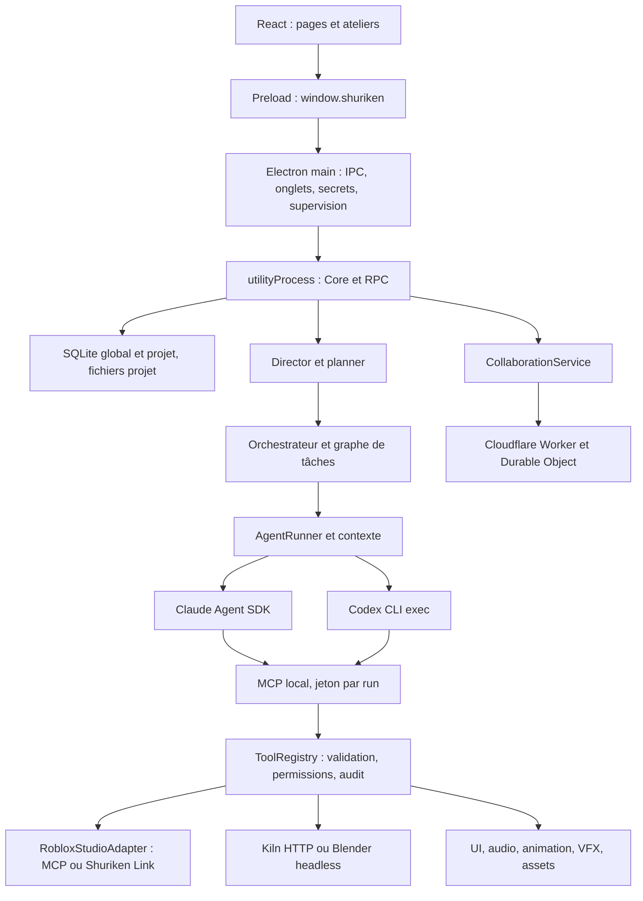

# Audit technique de Shuriken Studio

Date : 11 novembre 2026, Europe/Paris. Version locale : 1.16.2.
Branche de développement conservée : `feature/codex-integration`. Commit audité : `7400f17`.
Référence de comparaison locale : `main`, commit `599195ab4dd7bb4d325028e6d41b67c0075ae75a`.

## Périmètre, méthode et limites

Audit du dépôt local et de ses chaînes critiques : processus Electron, stockage, orchestration,
Claude/Codex, permissions/MCP, Studio, Kiln/Blender, interface et collaboration.
Les sources et les tests priment sur la documentation. L'examen couvre les familles de composants ;
il ne constitue pas une lecture exhaustive de chaque ligne ni une certification de sécurité.

Serena TypeScript a servi à explorer les symboles et à lire les méthodes concernées. Aucun graphe
Graphify n'existait ; aucun graphe n'a été créé et aucun code n'a été envoyé à un service distant.
Les skills Graphify, OpenAI Docs, roblox-studio-mcp, blender-mcp-master et blender-core ont été consultés. La documentation officielle de Codex a été
comparée au contrat local ; la CLI locale 0.166.0 a seulement été interrogée pour sa version,
son aide et le canal de sortie de `login status`. Aucune inférence payante n'a été lancée.

Le répertoire `.serena/` était déjà non suivi à l'ouverture. Aucun fichier source applicatif,
verrou de dépendances ou test existant n'a été modifié. Aucun commit, changement de branche, PR,
publication ou déploiement. Les ajouts sont `AGENTS.md`, `AI_INDEX.md` et ce dossier d'audit,
avec des sondes reproductibles. Les dépendances ont été installées avec autorisation explicite,
sans scripts d'installation. `node_modules/` et `out/` sont des sorties ignorées par Git.

Les reproductions utilisent de faux événements, de faux clients ou des processus enfants créés
par la sonde. Elles ne modifient ni un Studio ni un Blender/Kiln ouvert. Les comptes fournisseurs,
quotas réels, publication Roblox, rendu d'un projet utilisateur, application Electron installée et collaboration
sur deux PC ne sont pas validés par cet audit.

## A. Résumé exécutif

**L'architecture est cohérente et mérite d'être conservée. La branche Codex/collaboration ne doit
pas encore être considérée comme qualifiée pour un fonctionnement autonome fiable.**

Le moteur détient réellement les tâches, les permissions MCP, les vérifications et la mémoire
durable. Les fournisseurs sont des travailleurs remplaçables. Il existe un ordonnancement,
des dépendances, des tentatives bornées, une critique distincte, des reprises et une coordination
des accès Studio. Ce n'est pas simplement une juxtaposition de fenêtres de chat.

Les points faibles se situent aux frontières : le contrat du runner n'est pas entièrement
respecté par Codex ; les protections contre les fichiers en cours d'édition ignorent ses patches ;
un arrêt Windows peut laisser un descendant vivant ; le mode d'authentification est lu sur le
mauvais flux. Kiln peut annoncer le succès alors que l'export Roblox a échoué. Une mesure de
performance incomplète peut être acceptée. La navigation Electron autorise un faux hôte localhost.

TypeScript et la compilation Electron/renderer passent. Les 61 tests ciblés passent également.
La suite complète donne 2 060 réussites, deux échecs reproductibles et 19 tests ignorés sur 2 081.
Les échecs concernent la portabilité/isolation des tests ; les sondes supplémentaires reproduisent
des défauts applicatifs que cette couverture ne détecte pas. Des tests Blender headless réels
réussissent aussi sur des scènes temporaires, sans toucher aux scènes ouvertes.
L'analyse npm trouve 21 entrées de paquets affectés (1 critique, 7 élevées, 13 modérées), avec
des conditions d'exploitation à examiner : ce total n'est ni un nombre d'exploits démontrés ni
21 vulnérabilités indépendantes du produit.

Aucun P0 démontré. Les défauts P1 justifient une stabilisation ciblée avant généralisation de
Codex, de la collaboration ou d'une utilisation sans supervision. Aucune refonte globale n'est
justifiée par les preuves recueillies.

## Cartographie et dépendances critiques

| Zone | Sources principales | Rôle et dépendances |
|---|---|---|
| Processus/OS | `src/main/index.ts`, `kiln-host.ts`, `kiln-dock.ts` | Un core par onglet, redémarrage, IPC, DPAPI, vues et docks |
| Frontière renderer | `src/preload/index.ts`, `src/renderer/src/lib/rpc.ts` | API explicite, événements, lectures groupées, rafraîchissement et erreurs |
| Composition | `src/core/core.ts`, `src/core/index.ts`, `src/core/rpc/router.ts` | Construction des services et point d'accès aux opérations |
| État | `src/core/db/store.ts`, `schema.ts`, `projects/`, `audit/` | SQLite synchrone, WAL, transactions, migrations, journaux, miroirs et artefacts |
| Agents | `agents/roles.ts`, `tasks/task-graph.ts`, `orchestrator/` | Rôles, outils autorisés, sorties structurées, dépendances, rework et reprise |
| Contexte | `context/context-compiler.ts`, `knowledge/`, `planner-session.ts` | Budget par défaut 28 000 tokens estimés ; priorités, sections omises, notes persistantes |
| Fournisseurs | `providers/types.ts`, `provider-registry.ts`, `claude/`, `codex/` | Affectations par rôle ; fallback Claude vers Codex opt-in au prochain run |
| Autorisation | `permissions/`, `capabilities/tool-registry.ts`, `mcp/mcp-server.ts` | Zod, visibilité, audit, classe de risque, approbations, jetons par run |
| Studio | `roblox/studio-adapter.ts`, `link/`, `code-sync.ts`, `playtest-lease.ts` | Sélection instance/DataModel, file, baux, synchronisation et fusion à trois versions |
| Vérification | `verification/verifier.ts`, `test-service.ts`, `orchestrator/review-policy.ts` | Contrôles statiques/runtime, preuves, critique et régression |
| Création | `modeling/`, `blender/`, `ui/`, `effects/`, `audio/`, `animation/` | Ateliers spécialisés, stockage d'assets, export et import |
| Collaboration | `core/collaboration/`, `shared/collaboration.ts`, `collaboration/relay/` | Hôte autoritaire, invitations bearer, WebSocket, snapshots et requêtes invité |

Technologies effectivement installées : Node 25.0.0 (contrat projet >=24), Electron 44.4.5,
TypeScript 7.0.2, React 19.3.0, Tailwind 4.3.3, Three 0.186.1, electron-vite 5.0.0,
Vitest 4.1.11, Zod 4.6.5, MCP SDK 1.31.0, Claude Agent SDK 0.3.284, node-pty 1.1.0.

Les points de concentration sont `Core`, le routeur RPC, `AgentRunner`, le `ToolRegistry`, les
bases et l'adaptateur Studio. Un crash de core coupe les travaux de son projet, même si main
le relance. Le Studio et son DataModel restent des ressources partagées sérialisées ; multiplier
les agents ne multiplie pas la capacité de Studio. Le relais et le PC hôte sont indispensables à
la collaboration. Les verrous projet limitent l'ouverture du même projet dans plusieurs cores.

### Différences vérifiables du fork

`git diff --stat main...HEAD` : 40 fichiers, 4 109 insertions, 47 suppressions ; 138 commits
depuis le `main` local. Les ajouts principaux sont l'adaptateur Codex et son catalogue,
le fallback, la collaboration/client/relais/UI, des tests et la CI, ainsi que le lanceur Windows.
Le registre, le runner, le directeur et l'orchestrateur ont reçu des adaptations limitées.
Cette comparaison porte sur les références Git locales disponibles ; elle ne prouve pas que
le `main` distant n'a pas changé. La page publique du [dépôt de référence](https://github.com/lightnew10/shuriken-studio)
a été consultée ; elle ne remplace pas les sources de cette branche.

## B. État des fonctionnalités

« Fonctionnelle et vérifiée » ci-dessous est limité au scénario explicitement indiqué.

| Fonctionnalité | État | Vérification | Risques / limites |
|---|---|---|---|
| TypeScript et bundle application | Fonctionnelle et vérifiée | Commandes locales réussies | Pas un test de démarrage ou d'installeur |
| Lanceur Windows, précontrôle | Fonctionnelle et vérifiée | `--self-test` | Mise à jour/lancement non exercés |
| Persistance SQLite et migrations | Présente mais non testée de bout en bout | Code, tests ciblés manipulant des stores temporaires | Durabilité machine/crash OS non certifiée |
| Graphe de tâches, coordination et reprise | Présente mais non testée avec agents réels | Architecture et tests locaux, voir suite complète | Aucun jeu livré en scénario réel durant l'audit |
| Fournisseur Claude | Présente mais non testée avec compte réel | SDK, permissions et reprise inspectés | Authentification, quotas et coût réel non exercés |
| Codex : conversion JSONL, modèles et fallback | Partiellement implémentée | Tests simulés ciblés | Contrat de permissions/limites incomplet ; health sans inférence |
| Codex : exclusion du mode API payante | Défaillante | AUD-04, canal stderr confirmé sur la CLI locale | Peut accepter un login API comme abonnement |
| Codex : protections des fichiers en cours | Défaillante | AUD-02, contrôle Claude positif | Patches exclus des deux protections |
| Codex : arrêt de tous les processus Windows | Partiellement implémentée | Sonde native du mécanisme de spawn/kill | Descendant encore vivant après arrêt du wrapper |
| Roblox MCP : découverte et état | Fonctionnelle et vérifiée via le connecteur d'audit | Une instance réelle répond, mode Edit et DataModel Edit | Ce connecteur n'est pas le processus MCP lancé par Shuriken |
| Roblox Link et opérations applicatives | Présente mais non testée avec Studio réel | Code, simulations locales | Pas de confirmation d'une modification réelle via Shuriken |
| Synchronisation Luau/fusion | Fonctionnelle et vérifiée en simulation ciblée | Tests `code-sync` | Protection Codex défaillante, pas de multiclient réel |
| Performance : verdict de métriques absentes | Défaillante | AUD-06 | Faux « Within budget » possible |
| Kiln : export après modification Python | Défaillante dans le scénario reproduit | AUD-05, export simulé échoué | Succès affiché avec anciennes parts |
| Kiln modeleur : état de l'API locale | Fonctionnelle et vérifiée en lecture seule | GET app répond, version 0.8.8 et Blender déclaré | Aucun export ni modèle créé ou modifié |
| Blender MCP et pipeline réel | Impossible à déterminer pour le pipeline Shuriken | Processus Blender présent ; get_scene_info du connecteur échoue à se connecter | Cet échec du connecteur d'audit ne prouve pas une panne du bridge headless de Shuriken |
| Blender headless : meshes, textures, rigs, rendu et export | Fonctionnelle et vérifiée sur fixtures temporaires | Cinq tests Blender natifs réussis ; tests d'export/layout complémentaires réussis | Pas de scène utilisateur, validation artistique ou import dans un vrai Studio |
| UI : navigation, états et paramètres | Présente mais non testée visuellement | Code React/RPC et tests de logique | Electron absent après installation sans scripts |
| Ateliers UI/VFX/audio/animation | Présente mais non testée de bout en bout | Stores, validation et génération inspectés ; suite locale | Fidélité, téléphone et Roblox runtime non qualifiés |
| Collaboration : protocole/reconnexion | Fonctionnelle et vérifiée en simulation | Tests client et deux services | Le test « two cores » utilise deux services, pas deux vrais Core complets |
| Collaboration : exécution invité sur l'hôte | Partiellement implémentée | Admission et callback simulés | Pas de permissions fines par acteur ni preuve sur deux PC |
| Collaboration : déduplication de toute la session | Défaillante au-delà du cache | AUD-03 | Éviction après 500 autres reçus ; pas de journal durable |
| Chiffrement de bout en bout, révocation individuelle | Absente | Code et limitations documentées | Le relais peut lire les messages ; clé d'invitation commune |
| Mutualisation des abonnements invités | Absente | Aucun chemin de délégation raccordé | Ne pas déduire sa présence de l'UI collaborative |
| Déploiement Cloudflare / packaging Windows | Impossible à déterminer | Pas de déploiement ou d'installation | Dépendances relay séparées absentes |

### Agents : fonctionnement et garde-fous constatés

Les rôles fixent instructions, outils natifs/MCP, tiers de modèle, format de résultat et tours.
Le directeur transforme les demandes en objectifs ; le planner produit des tâches dépendantes.
L'orchestrateur choisit les tâches prêtes, réserve les fichiers exacts et des places d'exécution,
puis fait implémenter, vérifier et critiquer avant clôture. Les agents collaborent principalement
par les tâches, artefacts, contexte et mémoire du moteur, et non par un dialogue libre entre eux.

Le compilateur hiérarchise le contexte et le sauvegarde. Le planner conserve une session bornée
en âge et nombre de reprises ; les notes et bases permettent une reconstruction. Les sessions ne
sont reprises que pour le même fournisseur et la même version de l'app. Au redémarrage, les runs
actifs sont marqués interrompus, des tâches sont remises en file et les modifications partielles
restent sur disque. Cela ne garantit pas l'annulation d'une opération externe déjà exécutée.

Le plafond automatique par défaut est huit agents par projet, le maximum projet 32, le plafond
application 96 et la limite Studio par défaut quatre. Les fichiers exacts sont exclusifs mais
les dossiers sont partagés ; la sécurité dépend donc aussi de la détection des éditions en cours.
Les tentatives et continuations sont bornées côté orchestrateur. Codex ne respecte pas toutes
les bornes internes au run (AUD-01), ce qui ouvre une boucle longue à l'intérieur d'une tâche.

### Fournisseurs : degré d'isolation

Claude utilise le SDK, les sources de configuration sont explicitement isolées, les outils
natifs sont sélectionnés et `canUseTool` applique la politique du runner. Tours, budget, schéma,
effort, signal et reprise sont transmis. L'audit n'a pas vérifié la qualité de ses réponses réelles.

Codex utilise un sous-processus CLI et traduit ses événements JSONL. Prompts sur stdin, modèle
filtré, schéma temporaire, images, serveur MCP par run et reprise existent. Les jetons MCP sont
mis dans l'environnement plutôt que dans les arguments. Toutefois, permission/builtinTools,
effort, maxTurns et maxBudgetUsd ne sont pas effectivement appliqués par cet adaptateur.
Le coût est renvoyé à zéro avec `costReporting: false` : zéro signifie absence de mesure ici,
pas gratuité. Les quotas ne sont pas lus comme une mesure complète du compte ; les erreurs
sont classées par expressions régulières. Les deep checks Codex sont vides.

Le fallback est volontaire, évalué au prochain run, et revient à Claude quand celui-ci est
de nouveau disponible. Il ne migre pas une conversation active. Le découplage est une bonne
base, mais des consommateurs reconnaissent encore des noms d'outils Claude (AUD-02).
La [documentation officielle du mode non interactif](https://learn.chatgpt.com/docs/non-interactive-mode)
confirme le principe d'un flux JSONL et d'un sandbox ; elle ne garantit pas la conformité de cet adaptateur.

## C. Problèmes identifiés

Les lignes sont celles du commit audité. Les sondes « passent » lorsqu'elles constatent le
comportement défectueux actuel : ce ne sont pas des tests d'acceptation à conserver tels quels
après correction.

### AUD-01 — Contrat de rôle et limites ignorés par Codex — P1

- Sources : `src/core/providers/codex/codex-provider.ts:152-305` ; `src/core/orchestrator/agent-runner.ts:302-324,502-510` ; exemple réel de rôle critique lecture seule `src/core/agents/roles.ts:1439-1454` et copilotes `src/core/copilots/copilot-roles.ts:653-660`.
- Défaut : `run` n'utilise ni `req.permission`, ni `builtinTools`, ni `maxTurns`/`maxBudgetUsd`. En mode autonome, le sandbox workspace-write est donné indépendamment du rôle. Les protections MCP restent actives, mais ne contrôlent pas les outils natifs de Codex.
- Preuve : sonde AUD-01, rôle lecture seule, callback refusant tout, maxTurns=1 ; trois commandes simulées sont acceptées, callback jamais appelé, résultat ok et numTurns=4.
- Conséquences : un rôle de critique/copilote peut disposer de capacités natives non prévues ; les bornes du runner ne limitent pas un run Codex. Aucun dommage réel ou dépassement de facturation n'a été provoqué.
- Recommandation : négocier un contrat de capacités réellement supportées ; refuser les combinaisons incompatibles et faire appliquer les limites et autorisations par une interface de contrôle adaptée. Ne pas présenter le sandbox de fichiers comme équivalent aux règles applicatives.
- Confiance : élevée sur le défaut d'adaptation ; conséquences réelles dépendantes du rôle, du mode et du comportement du fournisseur.

### AUD-02 — Patches Codex invisibles à la protection des éditions en cours — P1

- Sources : `src/core/roblox/code-sync.ts:89-100`, `src/core/orchestrator/file-claims.ts:80-95` ; émission `codex-provider.ts:253-257` et collecte `agent-runner.ts:356-374`.
- Défaut : les lecteurs d'audit ne reconnaissent que Edit/Write/MultiEdit/NotebookEdit et file_path. Codex émet `Codex patch` avec `changes[].path`.
- Preuve : AUD-02 injecte exactement cette forme ; filesEditedBy, filesInFlight et editsInFlight ne trouvent rien. Le contrôle utilisant Edit retrouve le même fichier.
- Conséquences : une vérification ou un autre agent peut traiter le fichier sans savoir qu'un run Codex le modifie. Le suivi final editedFiles ajouté au runner ne répare pas cette coordination pendant le run ; l'événement file_change arrive en plus à la fin du patch.
- Recommandation : normaliser les modifications de fichiers dans un événement indépendant du fournisseur, exploité par l'audit et les protections ; gérer les réservations avant mutation.
- Confiance : élevée ; perte de données non provoquée dans un vrai projet.

### AUD-03 — Une requête déjà acceptée peut être exécutée de nouveau après éviction — P2

- Source : `src/core/collaboration/collaboration-service.ts:423-446`.
- Défaut : les reçus acceptés et rejetés partagent une Map limitée à 500. L'entrée la plus ancienne est supprimée. Les rejets remplissent le cache même quand l'exécution est désactivée.
- Preuve : AUD-03 accepte une requête, enregistre 500 rejets, réactive l'admission puis rejoue le premier UUID : le callback est appelé deux fois, dans la même session et sans crash.
- Conséquences : duplication de travail ou consommation de quota sur replay ; la limitation de huit nouvelles exécutions par minute ne protège pas le registre de déduplication.
- Recommandation : conserver les identifiants acceptés pendant la durée de validité des replays, séparer rejets/rate limiting et registre des opérations ; journal durable si reprise après crash promise.
- Confiance : élevée. Ce défaut dépasse la limite après crash déjà reconnue dans la documentation.

### AUD-04 — Le mode API Codex peut être accepté comme abonnement — P1

- Source : `src/core/providers/codex/codex-provider.ts:91-105`.
- Défaut : `authFor` cherche « api key » uniquement dans stdout, alors que commandOutput conserve aussi stderr.
- Preuve : AUD-04 simule succès CLI et message de mode API sur stderr ; authenticated=true et méthode Codex CLI login. La CLI 0.166.0 réellement installée renvoie son statut de connexion sur stderr, avec stdout vide. Aucun compte réel n'a été changé en mode API pour tester une facturation.
- Conséquences : la barrière « subscription mode » annoncée peut ne pas empêcher un compte API ; l'UI peut donner une information financière fausse. Le run n'effectue pas une seconde vérification de ce contrat.
- Recommandation : utiliser un statut structuré stable ou classifier stdout et stderr, échouer explicitement si le mode reste inconnu, tester les deux canaux et les variables d'authentification héritées.
- Confiance : élevée sur le parseur et le canal ; aucune dépense démontrée.

### AUD-05 — Échec d'export Kiln masqué par un succès Python — P1

- Sources : `src/core/modeling/kiln-modeling.ts:349-389,432-467` ; `src/core/capabilities/blender-tools.ts:47-55,127-130`.
- Défaut : publish journalise un export raté puis retourne size=null et notes vides. exec conserve ok=r.ok de l'exécution Python et retourne les anciennes parts. L'outil affiche done et peut annoncer que le modèle est sauvegardé et visible, puis présenter les anciennes parts Roblox.
- Preuve : AUD-05 exécute le vrai exec/publish avec un client synthétique : Python ok, export false ; résultat ok=true, error=null, changed=true, anciennes parts et aucune note d'erreur.
- Conséquences : divergence silencieuse entre scène Blender/Kiln et contenu Roblox exporté ; l'agent et l'utilisateur peuvent valider un état obsolète.
- Recommandation : distinguer réussite Python, sauvegarde, export et import ; propager un état partiel/échoué et invalider les parts obsolètes jusqu'à export confirmé.
- Confiance : élevée ; le runtime Kiln réel n'a pas été utilisé.

### AUD-06 — Métriques absentes acceptées comme performance mesurée — P2

- Source : `src/core/verification/verifier.ts:107-122`, appels `581,746`.
- Défaut : après erreur JSON, stats devient {} ; measured est vrai dès que le texte n'est pas null. Une métrique manquante vaut zéro pour la comparaison avec le budget.
- Preuve : AUD-06 exécute la fonction originale extraite sans modification ; un texte invalide et `{}` passent avec maxHeartbeatMs=16. Le cas `{}` peut traverser le filtre JSON utilisé par le playtest.
- Conséquences : faux feu vert de performance. Aucune affirmation possible sur FPS/mémoire d'un vrai jeu.
- Recommandation : valider un schéma de métriques finies et non négatives ; les valeurs requises manquantes donnent « non mesuré », jamais « dans le budget ».
- Confiance : élevée pour le verdict ; fréquence réelle non mesurée.

### AUD-07 — L'arrêt Windows ne tue pas nécessairement le processus Codex — P1

- Source : `src/core/providers/codex/codex-provider.ts:44-50,157-161,268-273` ; lancement comparable dans `codex-models.ts:39-43,61`.
- Défaut : shell=true lance un wrapper Windows ; child.kill() cible ce wrapper, pas nécessairement ses descendants. Le run ne possède pas de délai global assurant la fin du flux.
- Preuve native : `native-probes.mjs` crée son propre enfant Node avec le même mécanisme ; après kill du wrapper, le descendant est toujours vivant. La sonde arrête ensuite uniquement cet enfant. Aucun vrai run Codex n'a été interrompu.
- Conséquences : une annulation peut laisser calculs, outils ou quota actifs ; le runner peut attendre la fermeture des flux hérités. Ce dernier effet n'a pas été chronométré avec Codex réel.
- Recommandation : lancer directement un exécutable résolu quand possible ; posséder un groupe/arbre de processus, garantir l'arrêt de l'arbre et la clôture bornée du run.
- Confiance : élevée sur le mécanisme Windows reproduit ; application au vrai arbre Codex à confirmer en test contrôlé.

### AUD-08 — Arguments CLI avec espaces découpés par le shell Windows — P2

- Source : `src/core/providers/codex/codex-provider.ts:44-50,202-220`.
- Défaut : spawn avec shell=true concatène les arguments ; un chemin d'image ou de schéma contenant des espaces n'est pas protégé par le seul tableau d'arguments.
- Preuve native : l'argument unique synthétique `C:\Audit Folder\schema.json` est reçu comme deux arguments. Aucun fichier personnel n'est lu.
- Conséquences : échec d'entrée image ou de sortie structurée si le chemin temporaire contient des espaces, notamment selon le profil Windows. Aucune injection effective via une entrée utilisateur n'a été démontrée.
- Recommandation : éviter le shell en résolvant le binaire, ou utiliser une stratégie d'arguments Windows explicitement testée, incluant espaces et caractères spéciaux.
- Confiance : élevée sur le mécanisme ; le profil local courant sans espace ne reproduit pas ce cas par son propre chemin.

### AUD-09 — Liste d'autorisation de navigation Electron par préfixe — P1

- Sources : `src/main/index.ts:650-669,1227-1243` ; bridge `src/preload/index.ts:6-7` ; Markdown `src/renderer/src/components/ui.tsx:139-140`.
- Défaut : will-navigate accepte tout ce qui commence par `http://localhost` et tout file://. Un domaine étranger dont le nom commence par localhost satisfait le test. Les IPC généraux associent le WebContents au core sans vérifier l'origine du senderFrame.
- Preuve : AUD-09 évalue le prédicat original avec un domaine fictif non résoluble et le trouve autorisé. Aucune page hostile n'a été chargée et aucune chaîne d'exploitation complète n'a été exécutée.
- Conséquences : une navigation de ce WebContents vers du contenu non fiable peut conserver la surface preload/IPC privilégiée. sandbox/contextIsolation/nodeIntegration=false ne remplacent pas la validation de l'origine de l'appelant.
- Recommandation : parser l'URL et autoriser l'origine exacte du serveur de développement ou les seules pages applicatives prévues ; valider senderFrame pour les IPC sensibles, navigation et redirections.
- Confiance : élevée pour le défaut de prédicat ; impact complet conditionnel à une navigation et à la conservation du bridge.

### AUD-10 — Dépendances verrouillées signalées vulnérables — P1, exposition à qualifier

- Sources : `package-lock.json:1451,4113,4197` ; `src/core/mcp/mcp-server.ts:257-263` ; `src/renderer/src/components/ui.tsx:139`.
- Preuve : `npm audit --json`, code 1, 21 entrées : critique 1, élevées 7, modérées 13. Versions directes concernées : DOMPurify 3.4.16, MCP SDK 1.31.0 et Electron 44.4.5 ; d'autres entrées concernent l'outillage et ses dépendances.
- Qualification : l'avis DOMPurify critique exige SAFE_FOR_TEMPLATES et des modes DOM/shadow roots absents de l'appel actuel sanitize(string). Il ne démontre donc pas une XSS ici. Le serveur MCP authentifie avant le SDK, réduisant l'exposition non authentifiée, mais un client autorisé reste pertinent pour le déni de service de validation. Son parseur local accepte jusqu'à 8 Mio (`mcp-server.ts:321`), sans borne sur le nombre d'éléments des outils.
- Conséquences : surface connue nécessitant triage et mise à jour ; aucun exploit ni exfiltration reproduit. La gravité d'un paquet n'est pas automatiquement celle d'un défaut exploitable du produit.
- Recommandation : mises à jour ciblées compatibles, tests de contrat et durcissement du volume des entrées MCP. L'avis MCP précise qu'une mise à jour seule ne suffit pas : configurer aussi la limite d'éléments et la limite de requête. Ne pas appliquer automatiquement audit fix --force, dont les suggestions touchent aussi electron-builder.
- Sources externes : [avis MCP et mesures nécessaires](https://github.com/advisories/GHSA-46jr-4wx8-v453), [conditions de l'avis DOMPurify](https://github.com/advisories/GHSA-cg2g-xh64-v4q7). Résultat exact conservé dans [npm-audit.json](npm-audit.json).
- Confiance : élevée sur l'inventaire et les versions ; moyenne sur la portée réelle, faute de preuve d'exploitation.

### AUD-11 — Deux tests dépendent de la locale ou des logiciels du PC — P2, qualité des tests

- Sources : `tests/usage.test.ts:29`, `src/shared/usage.ts:78-83`, `tests/kiln-first.test.ts:198-204`, `src/core/modeling/kiln-launch.ts:61-72`.
- Défaut : le premier test exige une heure avec AM/PM, alors que clockText suit la locale du système ; le second simule l'absence de Kiln par un chemin configuré inexistant, mais le code recherche ensuite une installation réelle dans LOCALAPPDATA.
- Preuve : les deux échouent dans la suite complète, puis à nouveau seuls (16 réussites, deux échecs sur 18). La locale réellement observée est fr-FR et la fixture est formatée `21:12`, sans AM/PM. Kiln est installé et accessible ; le test de PC sans Kiln constate chat.size=1 au lieu de zéro.
- Conséquences : suite rouge selon le PC, difficulté à distinguer une régression produit. Ces échecs ne prouvent pas une panne de remise à zéro des quotas ni de démarrage de Kiln.
- Recommandation : injecter locale/horloge dans le premier scénario et isoler la découverte d'installation dans le second (mocks ou racines de recherche temporaires), sans modifier les paramètres réels de la machine.
- Confiance : élevée sur les échecs reproductibles et le format horaire ; élevée sur la dépendance à l'installation visible dans le code, sans désinstaller Kiln pour la vérifier.

### Origine des constats par rapport au main local

| Constats | Attribution vérifiable |
|---|---|
| AUD-01/04/07/08 | Adaptateur Codex ajouté sur la branche de développement |
| AUD-02 | Hypothèses Claude préexistantes dans les lecteurs de fichiers, devenues incomplètes avec l'ajout de Codex ; correction partielle du runner déjà présente dans le fork |
| AUD-03 | Service de collaboration ajouté par le fork |
| AUD-05/06/09/11 | Fichiers concernés inchangés entre le main local et la branche ; défauts hérités, pas régressions attribuées à Codex |
| AUD-10 | Verrou de dépendances identique au main local ; état des avis npm constaté au jour de l'audit |

### Risques et limites séparés des défauts reproduits

| Risque / limite | Éléments constatés | Ce qui n'est pas prouvé |
|---|---|---|
| Configuration Codex héritée | Aucun équivalent au strictMcpConfig et settingSources=[] de Claude ; exécution dans le profil CLI | Des MCP externes ou hooks dangereux effectivement actifs sur ce PC |
| Permissions des invités | Opt-in par session et pipeline de l'hôte ; identité ajoutée au chat/audit, pas une autorité fine propagée à chaque outil | Invité capable de contourner le gate local de publication via MCP |
| Relais et invitations | TLS, clé commune, pas de chiffrement de bout en bout, révocation individuelle/expiration absentes | Compromission du relais ou accès extérieur effectif |
| Relais : abus et sockets pending | Limite par salle, handshake après ouverture, pas de délai d'authentification visible dans le Worker | Attaque à grande échelle ou coûts Cloudflare mesurés |
| Rejeu après crash de l'hôte | Déduplication client en mémoire, pas de journal transactionnel distribué | Garanties exactly-once ; la documentation signale déjà cette limite |
| Règles shell et Luau heuristiques | Classes et expressions régulières, mode autonome par défaut dans owner-gate | Isolation de sécurité complète face à un modèle adversarial |
| Blocage/performance du core | SQLite et traitements synchrone ; core et orchestrateur concentrent beaucoup de code | Fuite mémoire ou ralentissement utilisateur quantifié |
| UI/runtime | Pages et opérations raccordées au RPC, états de chargement/reconnexion présents | Qualité visuelle, DPI, thèmes, accessibilité et fluidité réelle |

## D. Évaluation indicative de l'architecture

Ces notes sont un jugement d'audit fondé sur les preuves disponibles, pas une mesure objective.
Une absence de test réel limite la note sans prouver que la fonctionnalité est cassée.

| Dimension | /10 | Justification |
|---|---:|---|
| Architecture générale | 7 | Séparation de processus et état contrôlé par le moteur ; composition et main très concentrés |
| Fiabilité des agents | 6 | Graphe, reprise, checks/critique et bornes ; contrat Codex et fichiers en cours incomplets |
| Modèles IA | 5 | Claude structuré et interface commune ; Codex expérimental, permissions/auth/arrêt à stabiliser |
| Roblox | 6 | Adapter, Link, baux et fusion élaborés ; résultat réel non confirmé durant l'audit |
| Blender/Kiln | 6 | Tests Blender headless, exports et rigs réussis ; faux succès de l'export Kiln démontré |
| Sécurité | 4 | Sandbox Electron, DPAPI, jetons MCP et validation ; origine/navigation et écarts Codex importants |
| Performances | 5 | Plafonds, debounce/coalescing et workers ; bundle renderer 4,39 Mo, pas de profilage runtime |
| Maintenabilité | 6 | Types stricts, modules spécialisés et docs ; main 2 029 lignes, core 1 836, orchestrateur 2 420 |
| Qualité des tests | 6 | 2 060 tests réussis, native Blender inclus ; deux tests non portables, trous de contrat et CI limitée au fork |

La coopération existante est utile : ordonnancement par dépendances, connaissances durables,
audit des outils et vérifications forment une base plus robuste qu'une collaboration dépendant
uniquement des conversations. Le principal travail d'architecture est de rendre ces contrats
identiques entre fournisseurs et de définir une frontière d'autorisation propre aux invités.

## Vérifications réellement exécutées

Les premières commandes sans dépendances ont échoué (tsc/electron-vite/vitest introuvables).
L'installation a été autorisée par l'utilisateur. Un premier npm ci a échoué sur ENOTFOUND dans
le bac à sable ; sa relance autorisée hors bac à sable a réussi. Les tests ciblés ont d'abord
échoué avant import sur EPERM/rename du cache Vitest ; hors bac à sable, ils passent. Ce sont
des limites d'exécution de l'audit, pas des régressions imputées au code.

| Commande | Résultat | Limites / cause d'un blocage |
|---|---|---|
| `node --version`, `npm --version` | v25.0.0 / 11.20.0 | Environnement d'audit, pas runtime Electron embarqué |
| `npm ci --ignore-scripts --no-audit --no-fund` | 506 paquets installés en 29 s après relance | Scripts natifs/install Electron non exécutés ; aucun changement du verrou |
| `npm run typecheck` | Réussite, code 0 | Projets node et web ; relay séparé non inclus |
| `npm run build` | Réussite, code 0 | Main/core/preload/renderer ; pas packaging ou démarrage |
| `npm test -- --maxWorkers=2 tests/codex-provider.test.ts tests/codex-fallback.test.ts tests/codex-models.test.ts tests/collaboration-protocol.test.ts tests/collaboration-service.test.ts tests/collaboration-two-cores.test.ts tests/permission-prompts.test.ts tests/permission-settings-rpc.test.ts tests/file-claims.test.ts tests/code-sync.test.ts` | 10 fichiers, 61 tests réussis, 12,60 s | Simulations, stores temporaires, aucun fournisseur réel |
| `npm test -- --maxWorkers=2 --reporter=json --outputFile=docs/audits/2026-11-11/full-tests.json` | Code 1 : 2 060 réussis, deux échoués, 19 ignorés ; 218 fichiers, 744,36 s | AUD-11 ; tests standard seulement, E2E exclus |
| `npm test -- --maxWorkers=1 tests/usage.test.ts tests/kiln-first.test.ts --reporter=json --outputFile=docs/audits/2026-11-11/recheck-failures.json` | 16 réussis, les deux mêmes échecs sur 18 | Confirmation ciblée sans changement de locale ni d'installation Kiln |
| `node node_modules/vitest/vitest.mjs run --config docs/audits/2026-11-11/probes.config.mjs --reporter=json --outputFile=docs/audits/2026-11-11/probes-results.json` | 7 sondes réussies | Démontrent les défauts AUD-01 à 06 et 09 ; mocks ou fonction originale extraite |
| `node docs/audits/2026-11-11/native-probes.mjs` | Réussite | Sous-processus Windows, arguments avec espaces, arrêt du wrapper, canal du statut Codex ; pas de vrai run IA |
| `cmd /c Lancer-Shuriken.bat --self-test` | Réussite | Ne fetch/merge/lance rien |
| `npm ls --depth=0` | Réussite | Dépendances installées cohérentes avec l'arbre, pas analyse de code mort |
| `npm audit --json` | Code 1, 21 entrées de paquets affectés | Métadonnées transmises à npm, aucun code source ; exploitabilité à qualifier |
| `npm run typecheck` dans `collaboration/relay` | Échec TS2688 | @cloudflare/workers-types absent ; aucune dépendance supplémentaire relay installée |
| `codex --version`, `codex exec resume --help` | CLI 0.166.0 et aide accessibles | Avertissement accès aux alias temporaires dans le bac à sable ; aucune reprise exécutée |
| Roblox MCP `list_roblox_studios`, `get_studio_state` | Une instance réelle accessible, mode Edit | Lecture seule par le connecteur d'audit ; aucun Luau, Play ou changement de place |
| Blender MCP `get_scene_info` | Connexion impossible | Processus ouvert mais addon/endpoint du connecteur non accessible ; cause précise non déterminée |
| GET local Kiln `/api/v1/app` | Réponse réelle, 0.8.8 et Blender déclaré | Jeton lu seulement en mémoire, aucune scène modifiée ; pas un test d'export |

Pas de script lint dans package.json. Aucun lint général inventé ou présenté comme exécuté.
Les tests de règles dans Vitest ne sont pas équivalents à un linter global.
Pas de wrangler smoke/dry-run, faute de dépendances relay installées. Pas de `npm run dev`,
`dist`, test natif Electron ou E2E fournisseur/Studio : l'exécutable Electron n'a pas été téléchargé
par l'installation sans scripts, et les E2E ont des effets et consomment du quota réel.

Les deux premiers essais d'ajout des sondes AUD-05/06 ont échoué à cause de doubles de test
incomplets et de l'usage d'une API de compilation indisponible. Ces sondes ont été corrigées
sans modifier l'application, puis réexécutées avec succès. Les preuves finales sont dans
[probes-results.json](probes-results.json) et [native-results.json](native-results.json).

L'état des intégrations est consigné sans identifiants ni secrets dans
[integrations-status.json](integrations-status.json). Le serveur MCP nommé Kiln exposé dans
l'environnement concerne l'impression 3D, un autre produit ; il n'a pas été confondu avec
le modeleur Kiln que le dépôt utilise par HTTP local. La disponibilité de Studio et de cette
API Kiln ne valide pas leur intégration de bout en bout dans l'application auditée.

### Suite complète : complément final

La commande a terminé avec le code 1 après 744,36 secondes (environ 12 min 24 s).
Sur 218 fichiers et 2 081 tests : **2 060 réussites, deux échecs et 19 ignorés**.
Les deux fichiers échoués sont `kiln-first.test.ts` et `usage.test.ts`, documentés dans AUD-11.
Leurs relances ciblées reproduisent exactement les deux échecs. Il ne faut pas présenter la suite
comme entièrement verte, ni transformer l'environnement pour masquer ces échecs.

Les 19 tests ignorés concernent principalement Selene/luau-lsp ou la validation de programmes Luau
(16 tests), et des assets de référence non présents du scénario drift map (deux tests), ainsi
qu'un parseur Luau offline conditionnel (un test). Ils ne sont pas validés.

Les tests Blender natifs ne sont pas ignorés : `blender.test.ts` réussit ses cinq cas, dont
découpe en MeshParts, texture émissive/vertex colors, UV/PNG/GLB, workspaces parallèles avec
rendu/check/undo/propriété et export de rig/animations. Huit fichiers Blender/export/layout
sélectionnés représentent 53 tests réussis au total, certains étant des contrôles auxiliaires.
Cela prouve ces parcours sur scènes temporaires avec Blender headless, pas leur import complet
dans Roblox Studio ni la fidélité artistique d'un projet utilisateur.

Résultats bruts : [suite complète](full-tests.json), [journal de commande](full-tests.log),
[confirmation des deux échecs](recheck-failures.json). Les sorties générées sont des preuves
locales d'audit, pas des fichiers à publier automatiquement.

## E. Plan d'amélioration proportionné

Efforts en jours de développement, fourchettes indicatives pour une personne connaissant le code,
hors attente de comptes/déploiement et validation artistique. Les recommandations ne sont pas appliquées.

### Priorité 1 — Stabilisation

| Action | Effort | Dépendances | Risque de régression | Bénéfice / critère de succès |
|---|---|---|---|---|
| Fermer la navigation Electron et valider l'origine IPC (AUD-09) | 1–2 j | Pages de prod/développement et docks | Moyen : navigation locale | URL étrangère et frame non autorisée refusées, pages légitimes fonctionnelles |
| Imposer le contrat Codex : rôles, budgets, limites (AUD-01) | 3–6 j | Choix du contrôle CLI/app-server, capacités réellement disponibles | Élevé pour workflows Codex | Chaque restriction refusée avant effet ; limites vérifiables, aucune réussite silencieuse hors contrat |
| Garantir arrêt et passage d'arguments Windows (AUD-07/08) | 1–3 j | Résolution du binaire/arbre de processus | Moyen | Plus aucun descendant après annulation ; espaces/images/schémas correctement reçus |
| Corriger l'authentification subscription-only (AUD-04) | 0,5–1 j | Contrat CLI de statut | Faible à moyen | API sur stdout/stderr et mode inconnu refusés, abonnement reconnu |
| Normaliser les éditions en cours (AUD-02) | 2–3 j | Runner, audit, synchronisation | Moyen | Deux providers concurrents ne synchronisent pas le fichier détenu par l'autre |
| Propager l'échec d'export et l'absence de métriques (AUD-05/06) | 1–2 j | États UI/outils et vérification | Moyen | Aucun done/export validé sur ancien asset ; aucune métrique absente acceptée |
| Trier et corriger les avis npm (AUD-10) | 1–3 j | Versions compatibles et limites SDK | Moyen à élevé | Avis pertinents supprimés ou mitigés, tests ciblés et build stables |

### Priorité 2 — Amélioration

| Action | Effort | Dépendances | Risque | Bénéfice / mesure |
|---|---|---|---|---|
| Registre de requêtes et rejets séparés (AUD-03) | 1–3 j | Identité de session et politique de replay | Moyen | Rejouer un UUID accepté ne déclenche pas deux travaux après éviction/reconnexion |
| Propager l'acteur invité et ses permissions jusqu'aux outils | 3–6 j | Modèle d'autorisation host/guest | Élevé | Publication, dépenses, suppression et changement de sécurité suivent une politique testable par acteur |
| Étendre la CI aux contrats communs et aux tests de sécurité | 1–2 j | Temps CI, scénarios déterministes | Faible | Même contrat sur Claude/Codex ; défauts reproduits échouent avant correctif puis passent |
| Rendre les tests indépendants de la locale et du Kiln installé (AUD-11) | 0,5–1 j | Injection de locale et de découverte d'exécutable | Faible | Suite stable en fr-FR/en-US avec et sans Kiln installé |
| Qualifier le relay avec dépendances maîtrisées et smoke local | 1–2 j | Autorisation d'installation et outillage Cloudflare | Moyen | Typecheck, handshake, expiration, rate limits, reconnections et refus d'acteurs testés |
| Profiler le runtime puis optimiser les points mesurés | 2–4 j | Binaire Electron, données synthétiques représentatives | Faible | CPU/RSS/latence RPC, démarrage et taille de bundle mesurés avant/après |
| Extraire progressivement les grandes zones main/core/orchestrateur | 2–5 j ciblés | Tests du module visé | Moyen | Réduction de couplage à comportement identique ; pas de découpage gratuit |

### Priorité 3 — Évolution

| Action | Effort | Dépendances | Risque | Bénéfice |
|---|---|---|---|---|
| Journal collaboratif durable et reprise après crash | 3–6 j | Admission/idempotence et transactions | Élevé | Traçabilité, états explicites pending/accepted/executed/failed |
| Invitations individuelles, expiration et révocation | 2–4 j | Identité des membres et relay | Moyen | Retrait d'un invité sans fermer toute la salle |
| Chiffrement de bout en bout si confidentialité requise | 5–10 j | Gestion des clés, multiappareils | Élevé | Réduction de la confiance accordée au relais |
| Qualification Windows + Studio sur deux PC | 2–4 j | Binaire installé, relay déployé et comptes de test | Moyen | Demande invité → agent hôte → changement Studio confirmé, panne réseau, arrêt et reprise |
| Délégation de comptes invités, seulement si support fournisseur | À étudier après cadrage | OAuth et droits officiellement supportés | Élevé | Attribution des quotas sans partager les fichiers de sessions personnels |

## F. Conclusion et réponses explicites

1. **Architecture cohérente ? Oui.** Les frontières processus, fournisseurs et intégrations ont
   un sens. L'état et les décisions restent majoritairement dans le moteur.
2. **Multi-agents réellement fonctionnel ? Présent et cohérent en simulation locale.** Les agents
   ont une orchestration et des artefacts communs. Cet audit ne prouve pas une construction autonome
   complète avec des comptes et un jeu réel ; les écarts Codex fragilisent la coopération concurrente.
3. **Codex fiable et bien intégré ? Partiellement intégré, pas encore fiable au niveau du contrat.**
   L'adaptateur est séparé et ses événements sont raccordés, mais permissions, limites, authentification,
   concurrence fichiers et arrêt Windows nécessitent des corrections.
4. **Utilisable sérieusement pour développer un jeu Roblox ? Comme outil assisté sous supervision,
   après qualification locale du pipeline choisi et sur un projet versionné.** Les preuves ne justifient
   pas une promesse de livraison autonome fiable, surtout avec Codex/collaboration sur cette branche.
5. **Cinq corrections à traiter d'abord :** origine/navigation IPC (AUD-09), contrat Codex avec arrêt
   et contrôle des limites (AUD-01/07), authentification abonnement (AUD-04), protection des fichiers
   Codex (AUD-02), propagation des échecs d'export (AUD-05). Le triage sécurité npm doit être mené
   en parallèle ; les métriques invalides et chemins avec espaces sont des correctifs ciblés proches.
6. **À conserver :** moteur indépendant d'Electron, état SQLite/migrations, contrat de fournisseurs,
   registre d'outils avec politique/audit, jetons par run, graphe de tâches, reprise/notes du planner,
   adapter Studio/Link/baux et fusion, séparation des ateliers et tests simulés.
7. **Refonte justifiée ? Non sur les éléments constatés.** Corriger les frontières et les contrats,
   renforcer les tests manquants et qualifier les parcours réels offre un bénéfice démontrable sans
   remplacer tout le système.

**Aucune correction n'est engagée. Toute modification du produit attend l'autorisation explicite de l'utilisateur.**
